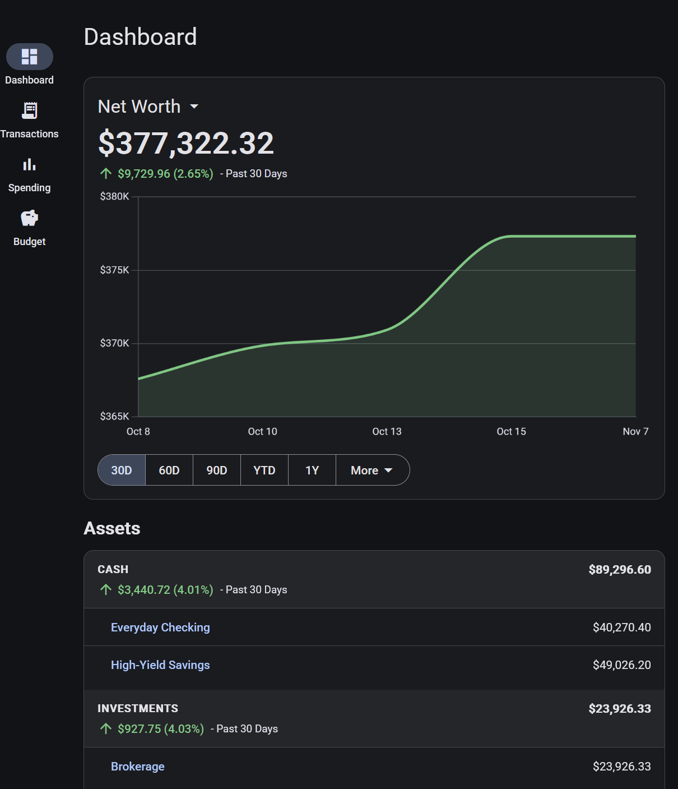

# Moped Finance

A self-hosted, single-user personal finance app. It runs as a container on any Docker host on your home network and keeps your accounts, transactions, budget and spending in your own Postgres database.

> **Status:** early and under active development. The first release, v0.1, covers manual accounts and runs as a container on a home server; bank sync is next. See the [roadmap](#roadmap).

## What it does

- **Accounts**: institutions and their accounts, assets and liabilities in groups (cash, investments, retirement, real estate, ...), with balances entered by hand or kept up to date by transactions, balance history imported from CSV, and closed or hidden accounts.
- **Transactions**: entered by hand or imported from CSV, split across categories, filtered and searched, and exported.
- **Categories**: income and expense categories in groups, marked essential or discretionary.
- **Budget**: recurring income and expenses, seen monthly, quarterly or yearly.
- **Spending**: what actually came in, went out and was saved in a period, against the budget.
- **Dashboard**: net worth and its history.
- **Settings**: light and dark themes, password, and API tokens for scripts.

## Roadmap

Each milestone ends with a tagged release; the details are in [TODO.md](TODO.md).

| Release | Milestone |
|---|---|
| v0.1 | **Initial release**: the core app with manual accounts, installable on a phone |
| v0.2 | Automated bank sync through [SimpleFIN Bridge](https://www.simplefin.org/), with automatic categorization: rules, and learning from your transactions |
| v0.3 | Real estate values from an online estimate |

Version 1.0 is the release that finishes the last of these. Reports and other tools arrive along the way, as the features around them need them.

## Running it

- **Development:** Node.js 24 and Docker. See [docs/development.md](docs/development.md).
- **Self-hosting:** one Docker image plus Postgres, on a private network. See [docs/deployment.md](docs/deployment.md).

Built with Angular, Node.js and Express, and PostgreSQL with Drizzle ORM.

## Docs

- [Development](docs/development.md): local setup, day-to-day commands, releases
- [Architecture](docs/architecture.md): packages, request flow, database
- [Testing](docs/testing.md)
- [Deployment](docs/deployment.md)
- [Code conventions](docs/conventions.md)
- [Requirements](docs/requirements/README.md): what the app does and will do, by domain
- [Backlog](TODO.md)

## Licence

[MIT](LICENSE)
