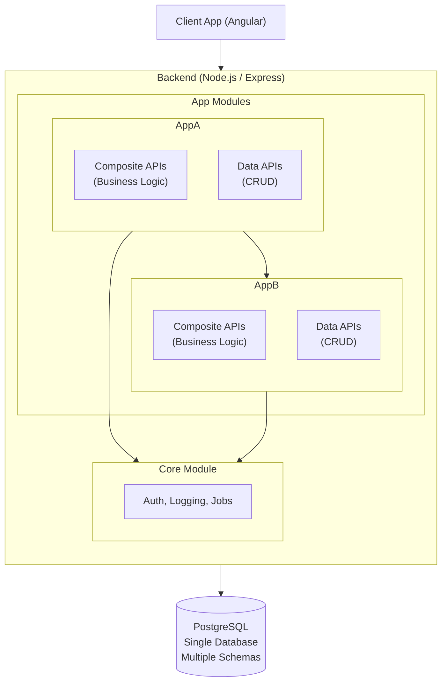

# Technical Architecture

## Modular Monolith
The platform uses a modular monolith approach where a single frontend and single backend handle multiple functional domains. This allows for logical separation of concerns while maintaining a simplified deployment and development workflow.

## Conceptual Architecture
The following diagram illustrates the high-level interaction between the major components of the system.

## Technical Stack
* **Frontend:** Angular 19+ (Single App).
    * Uses lazy loading for feature modules.
    * A shared `core` module provides common UI components, services, and authentication guards.
* **Backend:** Node.js / Express (Single App).
    * API is structured into modular routers based on application domains (e.g., `/api/finance`, `/api/grounds`).
    * Routers expose both simple "data" APIs for CRUD operations and "composite" APIs for more complex business logic.
    * Serves the static Angular application files in a production environment.
* **Database:** PostgreSQL 16.
    * A single database instance is used.
    * Logical separation for each application module is achieved using PostgreSQL schemas (e.g., `core`, `finance`, `grounds`).
    * The backend application manages a single connection pool to the database.
